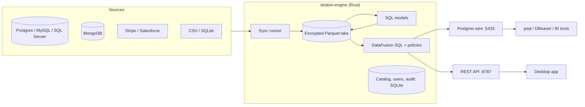

---
hide:
  - navigation
  - toc
  - footer
---

# Straton

**An open-source, self-hosted data platform written in Rust.** Connect your sources, sync them
into an encrypted local lake, transform them with SQL and query everything over the Postgres
wire protocol, with users, roles, row filters and column masks enforced inside the engine.

[Get started](getting-started.md){ .md-button .md-button--primary }
[View on GitHub](https://github.com/shiv-khetan/straton){ .md-button }

-   :material-database-sync-outline: **Sync**

    ---

    Postgres, MySQL, SQL Server, MongoDB, SQLite, CSV, Stripe and Salesforce. Full or
    incremental, resumable from the last committed checkpoint.

    [Sources and catalog →](guides/sources.md)

-   :material-code-braces: **Transform**

    ---

    SQL models as tables or views, run on a schedule or when an input changes, with an
    optimizer that removes provably redundant work.

    [SQL models →](guides/models.md)

-   :material-console: **Query**

    ---

    A read-only Postgres endpoint for psql, DBeaver and BI tools, plus a REST API. Results are
    bounded by row, memory and time limits.

    [SQL endpoint →](guides/sql.md)

-   :material-shield-lock-outline: **Govern**

    ---

    Default-deny API, per-source and per-dataset grants, row filters and column masks in the
    SQL engine, a hash-chained audit log and encrypted Parquet.

    [Access control →](guides/access-control.md)

-   :material-graph-outline: **Understand**

    ---

    Column-level lineage, impact analysis, data quality checks, profiling and run history in
    the desktop app.

    [Desktop app →](guides/desktop.md)

-   :material-server-outline: **Own it**

    ---

    One binary and a SQLite state file. Runs on Linux, Windows and macOS; no cloud account
    and no telemetry.

    [Deployment →](operations/deployment.md)

## How it fits together

Straton is pre-1.0. Interfaces may change between minor releases; see the
[changelog](project/changelog.md).
